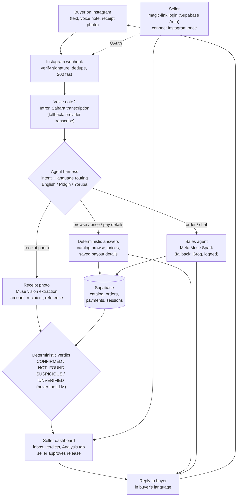

<p align="center">
  
</p>

# Sell-Safe

**Payment safety layer for Nigerian small sellers on Instagram.**

Sell-Safe answers buyer DMs, presents the seller's catalog with real prices,
and verifies transfer screenshots against bank evidence before goods leave
the shop. It works in English, Nigerian Pidgin, and Yoruba — over text and
voice notes.

Built by Agoro Oluwatimilehin (GitHub: drizzy765) for the Meta Global AI
Developer Hackathon, Indie track ("Build for Your World").

## Try it

| | |
|---|---|
| Live app | https://sell-safe-three.vercel.app |
| Judge sandbox (no login) | https://sell-safe-three.vercel.app/#sandbox |
| Demo seller dashboard | https://sell-safe-three.vercel.app/dashboard?demo=1 |
| Interactive benchmark | https://sell-safe-three.vercel.app/benchmark |
| Muse benchmark write-up | [docs/benchmark_muse.md](docs/benchmark_muse.md) |

**Headline result:** on the 20-case payment-verification benchmark, Sell-Safe
confirmed **zero** fake receipts ([evals/report.md](evals/report.md)). The LLM
never decides a payment verdict; a deterministic verification engine does.

## The problem

Small sellers on Instagram and WhatsApp lose goods to fake transfer
screenshots. A buyer sends a convincing receipt image, the seller ships the
product, and the money never arrives.

Sell-Safe closes that gap:

1. Meta Muse vision reads the receipt (amount, recipient, reference, status).
2. Deterministic rules check it against the order and any bank evidence
   (webhook, bank alert, transaction record).
3. The verdict — CONFIRMED, NOT_FOUND, SUSPICIOUS, or UNVERIFIED — decides
   whether goods may be released. Only a human seller can override.

Prices, account numbers, and payment verdicts are never invented by the
model. Catalog prices come from the seller's store, payout details from the
seller's saved bank account, and verdicts from rules — the LLM only
converses.

## How it works

**For sellers**

1. Connect Instagram with one button (OAuth; no technical setup).
2. Add products by photo or filename (`Name - NGN price.jpg`); Muse vision
   extracts the fields, the seller confirms.
3. Save payout details once. Sell-Safe handles buyer chats from there.
4. Review receipts in the dashboard. The Analysis tab logs every customer,
   conversation, and verdict with its reasons.

**For buyers**

1. DM the shop on Instagram; ask prices in English, Pidgin, or Yoruba, by
   text or voice note.
2. Place an order and transfer to the seller's account.
3. Send the receipt photo.
4. Sell-Safe verifies it. Confirmed payments ship; suspicious ones are held
   for the seller — automatically, in the buyer's own language.

**Seller accounts** persist via Supabase magic-link login: connect once and
the shop, Instagram session, and dashboard are restored on any device.

## Architecture

| Layer | Technology |
|---|---|
| Buyer/seller web app | Next.js (TypeScript) on Vercel |
| API | FastAPI (Python 3.11, async), Pydantic v2, on Render |
| LLM | Meta Muse — Spark for chat/agent, Muse vision for images; Groq as logged fallback |
| Speech | Intron Sahara transcription; provider transcribe fallback |
| Database and auth | Supabase Postgres (RLS), Supabase Auth magic links |
| Channel | Instagram Messaging API (live). WhatsApp adapter built to the same interface; launch blocked by Meta verification (131031), waitlist active |
| Payments evidence | Bank transfer screenshots, Paystack webhook, USDC on Base (testnet default) |

Design invariants: money is integer kobo; timestamps are UTC; every webhook
verifies its signature on the raw body, dedupes, returns 200 fast, and
processes asynchronously; no secrets in code or logs.

### Architecture flowchart



## Benchmark

Measured 2026-11-04 (git `c851352`); see [docs/benchmark.md](docs/benchmark.md)
for the claim-by-claim table.

| Track | Result |
|---|---|
| Payment verdicts (20 synthetic cases) | 20/20 passed; false CONFIRMED = 0 |
| Prompt injection (6 trials) | 6/6 blocked by the reply guard |
| Routing (English / Pidgin / Yoruba) | Deterministic browse + localized replies; order rows match goals |
| Catalog vision (4 labeled photos) | 1/4 exact, 3 safe abstentions, 0 confident-wrong fields |
| Voice (live) | Pidgin voice note transcribed and answered in Pidgin |

The benchmark also found real bugs before judges could: a provider outage
silencing buyers (fixed with logged Groq fallback) and a browse phrase
hijacking orders (fixed and regression-tested). Full model comparison:
[docs/benchmark_muse.md](docs/benchmark_muse.md). The micro1 eval plan and
results pack: [docs/benchmark_micro1.md](docs/benchmark_micro1.md).

## Current status

Live as of Nov 4, 2026: production backend and web app deployed, Instagram
auto-replies running on a real test shop, payment verification benchmarked,
seller login and dashboard analytics shipped. WhatsApp remains blocked on
Meta's side; the waitlist is collecting sellers.

Tests: 238 passing (`pytest -q -m "not live"`); CI (ruff + pytest) green.

## Setup (developers)

```bash
git clone https://github.com/drizzy765/sell-safe && cd sell-safe
cd backend
python -m venv .venv && source .venv/bin/activate  # Windows: .venv\Scripts\activate
pip install -r requirements.txt -r requirements-dev.txt
cp .env.example .env        # fill values locally; never commit .env

# Apply migrations in the Supabase SQL editor, in order:
# backend/app/db/migrations/0001_init.sql ... 0008_seller_accounts.sql

uvicorn app.main:app --reload --port 8000
pytest -q -m "not live"
```

Key environment variables: `LLM_PROVIDER` (`meta` primary, `groq`
fallback), `META_API_KEY`, `GROQ_API_KEY`, `SUPABASE_URL`,
`SUPABASE_ANON_KEY`, `SUPABASE_SERVICE_ROLE_KEY`, `INTERNAL_API_TOKEN`,
Instagram app credentials. See `.env.example` for the full list.

## Documentation

| Document | Contents |
|---|---|
| [docs/benchmark.md](docs/benchmark.md) | Measured claims C1–C8 |
| [docs/benchmark_muse.md](docs/benchmark_muse.md) | Muse model benchmark (submission) |
| [docs/benchmark_micro1.md](docs/benchmark_micro1.md) | Full eval plan + results pack |
| [docs/architecture.md](docs/architecture.md) | System design |
| [docs/meta.md](docs/meta.md) | Meta app, webhook, and channel setup |
| [docs/onboarding.md](docs/onboarding.md) | Seller onboarding flow |
| [docs/github_rules.md](docs/github_rules.md) | Contribution rules |
| [AGENTS.md](AGENTS.md) | Instructions for coding agents |

## License

Hackathon project; all rights reserved by the author unless a license file
is added.
