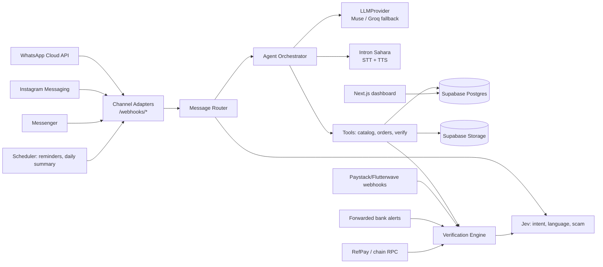
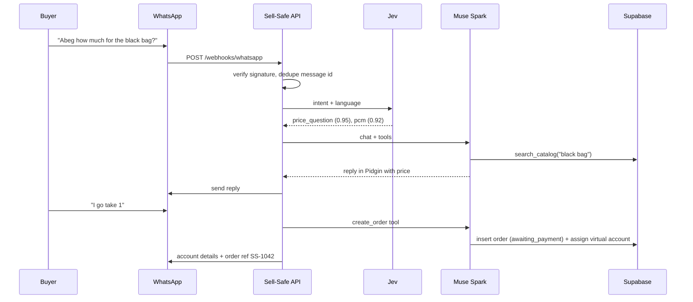

# Architecture / System Design

## Components


## Layout
```
app/
  main.py               FastAPI app, routers
  channels/             base.py (ChannelAdapter), whatsapp.py, instagram.py, messenger.py
  llm/                  base.py (LLMProvider), meta.py, groq.py
  jev/                  client.py, questions.py
  agent/                orchestrator.py, tools.py, prompts/{en,pcm,yo}.md
  verification/         extract.py, rules.py, matchers.py, verdict.py
  payments/             paystack.py, flutterwave.py, mono.py, refpay.py, alerts.py
  db/                   models.py, repo.py
  jobs/                 reminders.py, daily_summary.py
migrations/  tests/  evals/  demo/  dashboard/ (Next.js, optional)
```

## Channel adapter
```python
class ChannelAdapter(Protocol):
    name: Literal["whatsapp","instagram","messenger"]
    def verify_signature(self, raw: bytes, headers) -> bool: ...
    def parse(self, payload: dict) -> list[InboundMessage]: ...   # normalized
    async def send_text(self, to: str, text: str) -> str: ...
    async def send_image(self, to: str, url: str, caption: str) -> str: ...
    async def fetch_media(self, media_id: str) -> bytes: ...
```
`InboundMessage(channel, external_id, sender_id, seller_id, type[text|image|audio], text, media_id, ts)`. All three channels use Meta Graph webhooks with `X-Hub-Signature-256` (HMAC-SHA256 with app secret).

## LLM provider abstraction
Speech does not go through this protocol. See Speech below.
```python
class LLMProvider(Protocol):
    async def chat(self, messages, tools=None, json_schema=None) -> LLMResult: ...
    async def vision(self, image: bytes, prompt: str, json_schema) -> dict: ...
```
- `meta` (hackathon target): Meta Model API, base `https://api.meta.ai/v1` (checked 2026-10-26). Muse Spark series for text and tool calls. Muse vision for images. Muse Image and SAM 3.1 are the image-generation and segmentation models when those calls are added. Exact model ids are **TODO verify**. Env: `META_API_KEY`, `META_API_BASE_URL`, `META_TEXT_MODEL`, `META_VISION_MODEL`.
- `groq`: temporary dev fallback only, behind `LLM_PROVIDER`. OpenAI-compatible `https://api.groq.com/openai/v1`. Used when Meta credits are not available, and as the one-shot timeout fallback when both are configured. It is not the model the write-up claims. Exact fallback ids are **TODO verify**.

## Speech (Intron Sahara v2.5)
Buyer voice notes and voice replies use Intron, not the LLM provider. Key: `INTRON_API_KEY` (Bearer). Model name in this design is Sahara v2.5; **TODO verify** the id the API expects if a request takes one.

**STT.** Language codes from the [supported-languages](https://docs.voice.intron.io/docs/stt/supported-languages) page (checked 2026-10-26): Yoruba-English `yo` and Pidgin-English `pcm` are code-switched; English `en` too. Igbo-English `ig` and Hausa-English `ha` are stretch. The transcribe URL is **TODO verify** against the STT reference before wiring. Store the transcript, language code, and ASR confidence on `messages` (confidence stays null if the response has no score; field name **TODO verify**).

**TTS.** `POST https://infer.voice.intron.io/tts/v1/generate` with `Authorization: Bearer`. JSON fields: `text`, `voice_language`, `voice_accent`, `voice_gender` (`male`/`female`), optional `output_audio_format` `wav` (default) or `opus`. Max 4096 characters. 30 requests/minute. A 503 after the long poll window includes a text id; poll [TTS status](https://docs.voice.intron.io/docs/tts/tts-status) instead of sending a second generate. Spec: [TTS generate](https://docs.voice.intron.io/docs/tts/tts-generate).

The [accents page](https://docs.voice.intron.io/docs/tts/supported-languages-and-accents) lists Yoruba (`yo` / accent `yoruba`) and Pidgin (`pcm` / accent `pidgin`), plus English with a `yoruba` accent (checked 2026-10-26). A live call still has to confirm those voices (**TODO verify**). If `yo` or `pcm` is rejected, speak the same reply as English with `voice_language=en` and `voice_accent=yoruba`. Money and verdict lines are still the fixed templates; TTS only reads that text. Voice replies are on the cut list. STT is not.

## Sequence: buyer order


## Sequence: payment verification


## Deployment
- API: Render or Railway (single web service + cron for jobs). Health check `/health`.
- DB/Storage: Supabase cloud. Private bucket `media/`, signed URLs only.
- Dashboard: Vercel (reads via Supabase anon key + RLS, seller-scoped).
- Local: `uvicorn` + `ngrok http 8000`.
- Secrets: platform env vars only.
