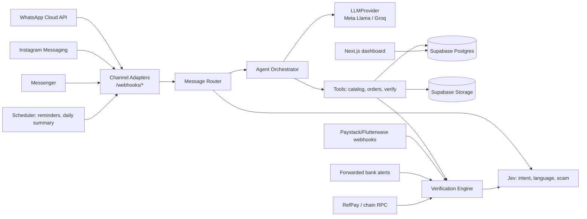
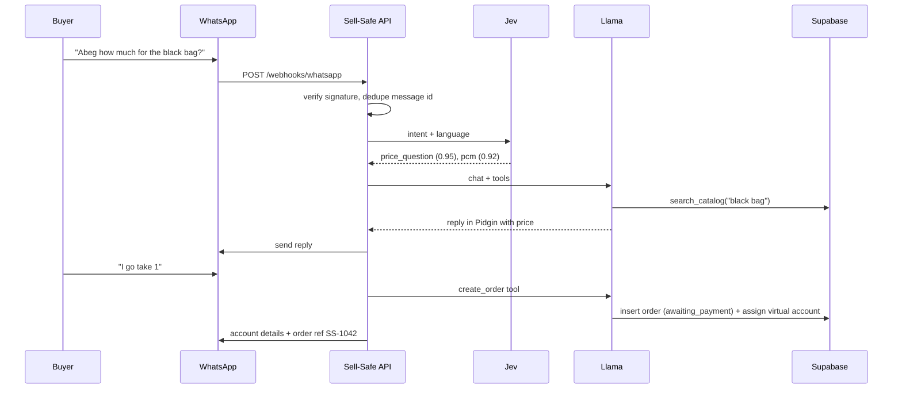
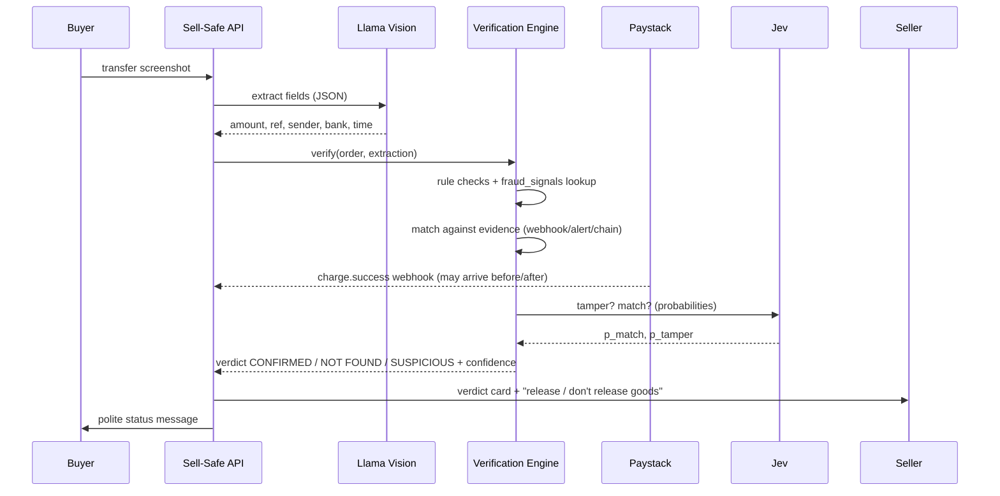

# Architecture / System Design

## Components


## Layout
```
app/
  main.py               FastAPI app, routers
  channels/             base.py (ChannelAdapter), whatsapp.py, instagram.py, messenger.py
  llm/                  base.py (LLMProvider), meta.py, groq.py
  jev/                  client.py, questions.py
  agent/                orchestrator.py, tools.py, prompts/{en,pcm,yo}.md
  verification/         extract.py, rules.py, matchers.py, verdict.py
  payments/             paystack.py, flutterwave.py, mono.py, refpay.py, alerts.py
  db/                   models.py, repo.py
  jobs/                 reminders.py, daily_summary.py
migrations/  tests/  evals/  demo/  dashboard/ (Next.js, optional)
```

## Channel adapter
```python
class ChannelAdapter(Protocol):
    name: Literal["whatsapp","instagram","messenger"]
    def verify_signature(self, raw: bytes, headers) -> bool: ...
    def parse(self, payload: dict) -> list[InboundMessage]: ...   # normalized
    async def send_text(self, to: str, text: str) -> str: ...
    async def send_image(self, to: str, url: str, caption: str) -> str: ...
    async def fetch_media(self, media_id: str) -> bytes: ...
```
`InboundMessage(channel, external_id, sender_id, seller_id, type[text|image|audio], text, media_id, ts)`. All three channels use Meta Graph webhooks with `X-Hub-Signature-256` (HMAC-SHA256 with app secret).

## LLM provider abstraction
```python
class LLMProvider(Protocol):
    async def chat(self, messages, tools=None, json_schema=None) -> LLMResult: ...
    async def vision(self, image: bytes, prompt: str, json_schema) -> dict: ...
    async def transcribe(self, audio: bytes) -> str: ...
```
- `groq`: OpenAI-compatible `https://api.groq.com/openai/v1`, Llama models (+ Whisper for transcription).
- `meta`: Meta Model API (dev.meta.ai). **TODO verify** base URL, model names, vision + tool-calling support from official docs before switching; config via `META_API_BASE_URL`, `META_TEXT_MODEL`, `META_VISION_MODEL`.
- If Meta lacks transcription, keep Groq Whisper for audio only and note it in the write-up.

## Sequence: buyer order


## Sequence: payment verification


## Deployment
- API: Render or Railway (single web service + cron for jobs). Health check `/health`.
- DB/Storage: Supabase cloud. Private bucket `media/`, signed URLs only.
- Dashboard: Vercel (reads via Supabase anon key + RLS, seller-scoped).
- Local: `uvicorn` + `ngrok http 8000`.
- Secrets: platform env vars only.
