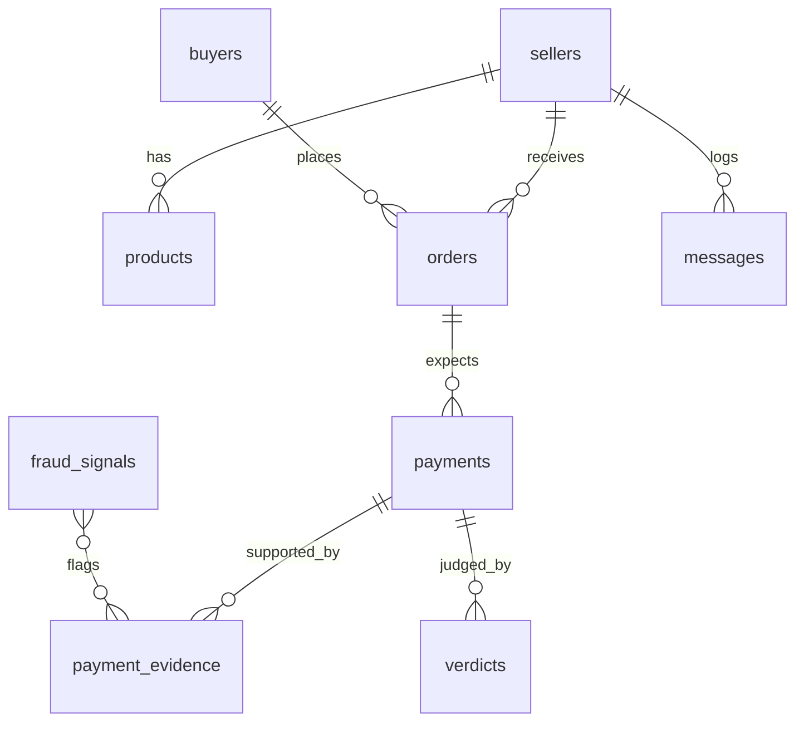

# Data Model (Supabase Postgres)
All tables: `id uuid pk default gen_random_uuid()`, `created_at timestamptz default now()`. Money stored as **integer kobo** (`amount_kobo`). Minimal PII: phone numbers stored hashed where only matching is needed (`*_hash` = SHA-256 with `PII_SALT`).

| Table | Key fields |
|---|---|
| **sellers** | name, business_name, channel_ids jsonb (`{whatsapp, instagram, messenger}`), phone_hash, default_language (`en`/`pcm`/`yo`), virtual_account jsonb (bank, number, provider, provider_customer_id), settings jsonb (auto_confirm bool, reminder_hours), active bool |
| **products** | seller_id fk, name, description, price_kobo, currency default 'NGN', stock int, image_path, tags text[], embedding vector (optional, pgvector), active |
| **buyers** | channel, external_id (channel user id), display_name, language, phone_hash, first_seen_at; unique(channel, external_id) |
| **orders** | seller_id, buyer_id, ref (e.g. `SS-1042`, unique), items jsonb `[{product_id, qty, unit_price_kobo}]`, total_kobo, status enum `draft, awaiting_payment, payment_review, paid, released, delivered, cancelled`, reminder_count, expires_at |
| **payments** | order_id, method enum `bank_transfer, virtual_account, crypto`, expected_kobo, status enum `pending, confirmed, not_found, suspicious`, confirmed_at |
| **payment_evidence** | payment_id, type enum `screenshot, va_webhook, mono_txn, bank_alert, chain_tx`, source_id (provider ref / tx hash / message id; unique per type → idempotency), extracted jsonb (amount_kobo, sender_name, sender_bank, sender_acct_last4, reference, txn_time, narration), raw_path (storage), trust_level int (1–4) |
| **verdicts** | payment_id, verdict enum `CONFIRMED, NOT_FOUND, SUSPICIOUS, UNVERIFIED`, confidence numeric, reasons text[], jev_scores jsonb, rule_hits text[], decided_by enum `auto, seller`, release_allowed bool |
| **fraud_signals** | kind enum `account_number, phone, device_hash, image_hash, name`, value_hash, reported_by_seller_id, evidence_id, severity 1–3, confirmed bool; index(kind, value_hash) |
| **messages** | seller_id, buyer_id, channel, direction `in/out`, external_msg_id (unique → dedupe), type, text, media_path, intent, language, jev_scores jsonb |
| **webhook_events** | provider, event_id unique, payload jsonb, processed_at (idempotency log) |
| **daily_summaries** | seller_id, date, orders, paid_kobo, fakes_caught, naira_saved_kobo |

**naira_saved_kobo** = sum of `expected_kobo` for payments with a SUSPICIOUS/NOT_FOUND verdict where goods were not released and no later CONFIRMED evidence arrived within 48h.

RLS: dashboard reads restricted to `seller_id = auth.uid()` mapping; the API uses the service role key server-side only.
