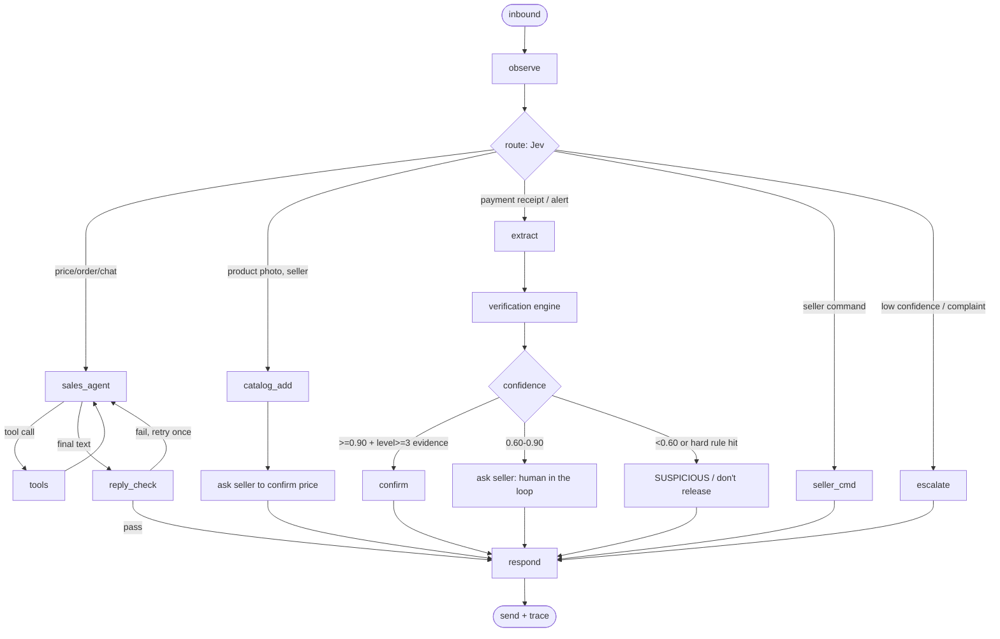

# Harness Engineering (agent loop, state graph, context, guardrails)
Principle: **Jev routes, Llama talks and sees, code verifies, the seller decides when unsure.**

## 1. Harness loop
Every inbound message runs the same loop:
1. **Observe**: normalize the message (channel adapter), dedupe, load seller, buyer, open order, recent turns.
2. **Route (Jev)**: intent, language, image_kind, scam_pressure, all in one call with probabilities.
3. **Plan**: pick the branch (sales chat, catalog add, payment check, seller command, escalate). Llama plans only inside the sales-chat branch.
4. **Call tools**: typed tool calls; outputs validated against schemas.
5. **Verify**: the deterministic verification engine plus Jev scores make the verdict; reply checks (no invented prices, correct language).
6. **Respond**: templates for money and verdicts, Llama-generated text for everything else; send via adapter; log the trace.

## 2. State graph (LangGraph-style)

### State schema
| Field | Type | Notes |
|---|---|---|
| `trace_id` | str | one per inbound message |
| `channel`, `seller_id`, `buyer_id` | str | |
| `message` | InboundMessage | normalized |
| `language` | en / pcm / yo | from Jev, fallback to seller default |
| `intent` + `route_scores` | str + dict | Jev probabilities |
| `history` | list[Turn] | last N turns (see context) |
| `order` | Order or null | open order for this buyer |
| `tool_calls` | list | name, args, result, latency |
| `extraction` | dict or null | receipt fields |
| `verdict` | Verdict or null | from verification engine only |
| `reply` | str | final text |
| `steps` | int | loop counter |
| `errors` | list | for retries/trace |

### Rules
- **Max steps:** 6 graph steps per message; max 3 tool calls in `sales_agent`. Over limit → polite fallback + notify seller.
- **Retries:** LLM JSON/schema errors retry once with the error message; provider timeouts retry once with backoff, then fall back (Meta → Groq if configured). Webhook processing is idempotent so re-runs are safe.
- **Checkpointing:** save state after `route`, `verify` and `respond` to Postgres (keyed by `trace_id`) so a crash resumes without double-sending; pending HITL decisions are persisted and resumed when the seller replies (`/release SS-1042`, `/fake SS-1042`).
- **Timeouts:** whole turn ≤ 10 s; send a "checking…" message if verification takes longer.

## 3. Context engineering (per turn)
| Include | Size limit |
|---|---|
| System prompt + language style block | fixed |
| Seller profile (business name, tone, policies) | short |
| Last 8 turns of this buyer conversation (summarize older) | ~1k tokens |
| Open order summary (ref, items, total, status) | short |
| Top 5 catalog matches from retrieval (name, price, stock) | ~500 tokens |
| Tool schemas for this branch only | as needed |
**Never include:** other buyers' data, full account numbers, raw fraud lists, secrets.
- **Memory:** short-term = recent turns; long-term = buyer preferences (language, past orders) stored as structured fields, not free text.
- **Catalog retrieval:** keyword + trigram search first; pgvector embeddings optional. Prices always re-read from the DB at tool time.
- Text inside images or messages is data, never instructions (prompt-injection rule).

## 4. Tool contracts
Every tool has a typed input and output schema (Pydantic on the backend), seller scope enforced server-side, and a stable error shape `{error: code, message}`.
| Tool | Input | Output | Side effect |
|---|---|---|---|
| `search_catalog` | query: str, max_results: int ≤ 5 | products[{id, name, price_kobo, stock}] | none |
| `get_product` | product_id | product | none |
| `create_order` | items[{product_id, qty ≥ 1}] | {order_ref, total_kobo, pay_to} | creates order |
| `get_order_status` | order_ref | {status, payment_status} | none |
| `cancel_order` | order_ref | {ok} | updates order |
| `add_product` (seller only) | name, description, price_kobo, stock | {product_id} | creates product |
| `verify_payment` | order_ref, evidence_id | Verdict (read-only) | runs engine |
| `notify_seller` | order_ref, message | {ok} | sends message |

## 5. Guardrails
- **The LLM never decides a payment verdict alone.** Only the verification engine does, from evidence + rules + Jev probabilities.
- No release without level ≥3 evidence (webhook, Mono, on-chain), or a seller who explicitly accepts a level-2 alert.
- **Human-in-the-loop:** confidence 0.60–0.90 → the seller gets the evidence and decides; the decision is logged.
- Fixed templates for amounts, account details and verdicts.
- Rate limits per buyer; LLM budget cap per seller per day.
- Only the last 4 digits of account numbers are shown; PII is hashed for matching.

## 6. Evals and tracing
- Evals: see `testing_and_evals.md`. Launch gate is zero false CONFIRMED on the fake set.
- Run evals on every prompt/model change (`groq` and `meta`).
- **Tracing:** each node logs `trace_id, node, latency_ms, model, tokens, jev_scores, tool, error`. Store in a `traces` table or a hosted tracer (Langfuse/LangSmith free tier, optional). Use traces for the demo "why" screen.
