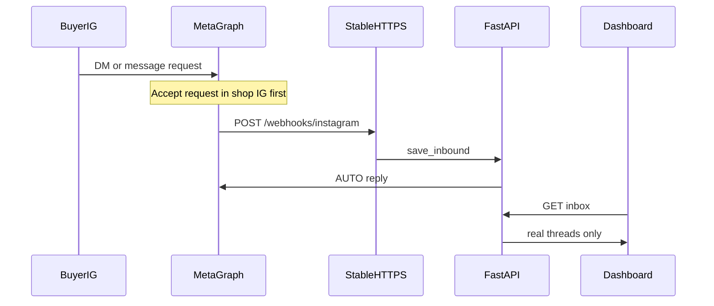

# Sell-Safe final plan (Dashboard v2 + benchmark)

**Date:** 2026-11-02  
**Freeze:** Nov 3–4 benchmark · Meta submission Nov 5, 02:00 WAT  
**Sources merged:** `sellsafe-dashboard-v2/DASHBOARD_INBOX_PROMPT.md`, `docs/onboarding.md`, `ONBOARDING_FEATURES.md`, Cursor plan *Benchmark MCP Plan*

While you install **Playwright / Puppeteer MCP**, use this as the single runbook. Do not commit `.env`, tokens, or Instagram passwords.

---

## 0. Honest product truths (say this to judges)

### Payments / “Opay”
Sell-Safe **does not log into Opay** (or any bank). Shop bank name / account name / account number = **expected recipient** for matching only.

| Path | Real life? | Role |
|---|---|---|
| Receipt screenshot | Detects fakes; never alone CONFIRMED | Muse extract → rules → Jev → `verdict.py` |
| Paystack / Flutterwave VA webhook | Yes if seller uses it | Strongest CONFIRMED |
| Forwarded bank SMS/email → `/alerts` | Partial | Level-2 evidence; spoofable unless from registered seller channel |
| Mono open banking | Optional | Not “connect Opay” |
| USDC on Base | Yes when configured | Buyer pastes tx hash |

**Golden rule:** screenshot alone never releases goods. Fake catch = amount/recipient mismatch, duplicates, tamper, no matching webhook → **SUSPICIOUS**. Demo must not claim Opay auto-alerts.

### Advertise
**Outreach pitch** (`ig.me/m/<handle>`, seller sends manually) — not Meta Ads Manager (Feature 4 backlog).

---

## 1. Previous plan — Dashboard v2 (approved mockups)

Mockups: `sellsafe-dashboard-v2/mockups/{inbox,catalog-home,approve-mode}.jpg`

### 1.1 Spec (P0)

1. **Inbox mirrors real Instagram DMs** — IG Direct layout; real webhook data only; empty = “No messages yet”; demo only via Settings; product cards; receipt verdict pills; Take over / Hand back.
2. **Reply modes** — AUTO | APPROVE | SMART (default AUTO); APPROVE = dashed draft Approve & send / Edit / Reject; SMART for discounts/payments/refunds/high ₦; 24h window warn.
3. **Catalog home** — logo, shop, Muse/AUTO pill, stats, product grid, Add products (IG / upload / Drive / …), skip banner.
4. **Sell from catalog in DMs** — match product, send photo + ₦, never invent prices; Drive folder `Sell-Safe Test Catalog - Mama Timi Provisions` (`Name - NGN price.jpg`).
5. **Outreach (P1)** — one-at-a-time pitch → edit → open Instagram; no cold mass API DMs.
6. **Backlog** — Orders board, Paystack links, abandoned follow-ups, Meta Ads, etc.

### 1.2 Acceptance tests (`@sellsafe.testshop.ng`)

1. No DMs → empty IG inbox (no fake chats).  
2. “how much be honey beans?” → inbox in seconds → AUTO photo + ₦6,000.  
3. APPROVE → draft → Approve sends to IG.  
4. Fake receipt → Suspicious.  
5. Pitch → draft + `ig.me/m/<handle>`.

### 1.3 Already implemented (Nov 2 code)

- Real inbox APIs + IG-style UI; demo opt-in Settings only.
- Reply modes + take over; draft approve/edit/reject in-thread.
- Catalog home UI; Drive import via `GOOGLE_DRIVE_API_KEY` + filename auto-approve into runtime catalog.
- `send_image` + product meta on AUTO replies when image URL is HTTP(S).
- Docs: `docs/onboarding.md`, Feature 3 checkboxes in `ONBOARDING_FEATURES.md`.

### 1.4 Still gaps (before / during benchmark)

| Gap | Why it bites |
|---|---|
| Ephemeral Cloudflare tunnel | OAuth/webhook DNS dies; forced reconnect |
| In-memory IG session / messages / shops | Restart wipes inbox + forces Connect Instagram |
| Meta webhook URL may still be old tunnel | DMs never hit API → empty dashboard |
| Message requests not accepted | Meta may not webhook until Accept in IG |
| Outreach UI mostly placeholder | Pitch flow not finished |
| Receipt pills / live verdicts on dashboard | Partial; verify path exists, UI wiring thin |
| Email approve links | Optional; in-dashboard approve enough for clip |
| Supabase publish path for all stores | Memory-first hackathon risk |

---

## 2. Current plan — benchmark unblock (MCP + deploy)

### 2.1 Why DMs did not show on dashboard

Inbox only shows rows from `POST /webhooks/instagram` → EchoStore → `GET /api/dashboard/inbox`.

1. Webhook still on dead tunnel hostname.  
2. uvicorn/cloudflared restart wiped memory.  
3. Seller id mismatch (Login `account_id` vs webhook recipient / `INSTAGRAM_ACCOUNT_ID`).  
4. Buyer stuck in **Message requests** (not Accepted).



### 2.2 MCP / browser (you are installing now)

**Goal:** Playwright and/or Puppeteer MCP so the agent can drive:

- `http://localhost:3000` (or deployed web) — Connect + dashboard  
- Meta Developer Console — webhook + OAuth URIs  
- Instagram web — shop account Accept requests; optional buyer account send DM  

**Credentials:** paste into chat for the live session only. Never into repo / `.env` / commits / fixtures. Prefer tester accounts; rotate after.

Prefer **one** browser MCP (Playwright) if both fight for the same Chrome profile.

### 2.3 Deploy + persistent Instagram login (agreed P0)

Ephemeral tunnel + memory session = reconnect hell.

**Chosen approach:**

1. Deploy FastAPI + Next to **stable HTTPS** (Railway / Fly / Render).  
2. Point Meta **OAuth redirect** + **Instagram webhook** at that host once.  
3. Persist Instagram sessions (token server-side, opaque cookie) in **Supabase**.  
4. Persist shops, catalog, messages so inbox survives restarts.  
5. Keep **Instagram Login** as seller identity (skip email/password for hackathon).

Local `trycloudflare` = emergency only.

### 2.4 P0 ladder (execute in order)

| Step | Action | Done when |
|---|---|---|
| **0** | Deploy stable host + persist IG session/catalog/messages | Connect once; restart API; still logged in; old DMs remain |
| **1** | Align Meta webhook + OAuth + verify token to live host | `POST /webhooks/instagram` 200 in logs on test DM |
| **2** | Browser: Accept Message requests on shop IG | Thread in Primary; new DM webhooks |
| **3** | Prove dashboard mirror | Buyer + preview in `/dashboard?tab=inbox` within seconds |
| **4** | Drive catalog import → honey beans AUTO reply | Catalog shows ₦; DM gets price (+ image if public URL) |
| **5** | APPROVE mode one draft → Approve & send | HITL clip |
| **6** | Outreach pitch → `ig.me/m/…` | Only if 0–5 green |
| **7** | Payment clip (honest) | Fake screenshot → SUSPICIOUS; CONFIRMED only via Paystack test or Base USDC |

### 2.5 Recordable benchmark script

1. Empty IG-style inbox (no demo filler).  
2. Import Drive test catalog → Honey Beans ₦6,000 on Catalog.  
3. Accept request → buyer asks price → Inbox → AUTO product reply.  
4. Switch APPROVE → draft → Approve & send.  
5. Optional: Outreach one handle.  
6. Optional: fake receipt → Suspicious (no Opay claim).

### 2.6 Explicit non-goals this freeze

- Meta Ads Manager / Marketing API  
- WhatsApp unlock  
- Full Orders kanban  
- Email one-tap approve (dashboard approve OK)  
- Building Opay/bank login  

---

## 3. Env / Meta checklist (operator)

```text
APP_BASE_URL=https://<stable-host>
INSTAGRAM_OAUTH_REDIRECT_URI=https://<stable-host>/api/instagram/oauth/callback
WEB_BASE_URL=https://<stable-web-or-localhost:3000>
GOOGLE_DRIVE_API_KEY=...
INSTAGRAM_ACCOUNT_ID=<professional account id, not /me app-scoped id>
INSTAGRAM_ACCESS_TOKEN=...   # outbound bot sends
META_VERIFY_TOKEN=...
```

Meta Instagram Login:

- Valid OAuth Redirect URI = same as `INSTAGRAM_OAUTH_REDIRECT_URI`  
- Webhook callback = `https://<stable-host>/webhooks/instagram`  
- Deauthorize / Data deletion → same host (`/privacy` for deletion)  
- Messages subscription **On** for test shop  

Drive folder: **Anyone with the link** · filenames `Honey beans - NGN 6000.jpg`

---

## 4. Master todo list

### A — Stability (do first)

- [x] Deploy API to stable HTTPS (Render: `https://sell-safe-api.onrender.com`). Web (Vercel) still open — web runs locally behind a tunnel.  
- [ ] Persist Instagram sessions in Supabase  
- [ ] Persist shops / catalog / messages (or at least sessions + messages)  
- [x] Point Meta OAuth + webhook at stable host (Render); dead trycloudflare URIs removed from Meta settings (2026-11-03)  

### B — Live inbox proof

- [ ] Confirm webhook POSTs in API logs  
- [ ] Accept IG Message requests (browser MCP)  
- [ ] Buyer DM appears in Sell-Safe Inbox  
- [ ] AUTO reply works  

### C — Catalog + modes

- [ ] Drive import Mama Timi test folder  
- [ ] Honey beans price question E2E  
- [ ] APPROVE draft Approve & send  
- [ ] Take over / hand back once  

### D — Stretch

- [ ] Outreach pitch + ig.me  
- [ ] Suspicious receipt clip (honest copy)  
- [ ] Paystack or Base CONFIRMED clip  

### E — MCP setup (you, now)

- [ ] Install Playwright MCP in Cursor (and/or Puppeteer if needed)  
- [ ] Restart agent chat; confirm tools appear  
- [ ] Ready to paste shop Gmail/password/handle for live browser session only  

---

## 5. Key code map

| Area | Path |
|---|---|
| IG webhook | `backend/app/api/webhooks/router.py` |
| Dashboard inbox APIs | `backend/app/api/internal/dashboard.py` |
| Inbox UI | `web/components/dashboard/InboxView.tsx` |
| Catalog UI | `web/components/dashboard/CatalogView.tsx` |
| Drive import | `backend/app/onboarding/drive_import.py` |
| Filename prices | `backend/app/onboarding/price_parse.py` |
| Reply modes / drafts | `backend/app/agent/graph/nodes.py` + `backend/app/db/inbox_control.py` |
| IG session (memory today) | `backend/app/db/instagram_session_store.py` |
| Payment rules / verdict | `docs/payment_verification.md`, `backend/app/verification/` |
| Alerts ingest | `backend/app/api/webhooks/alerts.py` |

---

## 6. Success criteria (ship / record)

- Primary DMs after Accept appear in dashboard without fake filler.  
- Catalog prices only from approved/Drive products.  
- One AUTO sale reply + one APPROVE flow on tape.  
- One stable host for the whole freeze (no DNS_PROBE mid-demo).  
- Payment narrative matches real architecture (no Opay login claim).  

---

*When Playwright MCP is connected, say “execute final plan” (start at step 0 deploy/persist or step 1 webhook green if deploy is deferred).*
